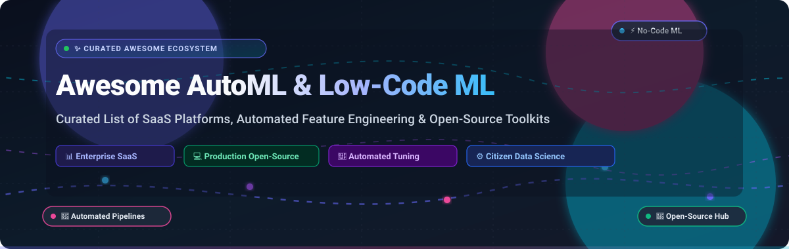

  

  
  
  
  
  
  
  
  

---

# 🤖 Awesome AutoML & Low-Code ML

> 🌟 **The Definitive Directory of Automated Machine Learning (AutoML), Low-Code AI Frameworks, and No-Code Predictive Platforms.**  
> Curated resources covering automated feature engineering, neural architecture search (NAS), hyperparameter optimization (HPO), model explainability (XAI), and zero-friction production deployment.

---

## 📌 Table of Contents

- [🌐 Sector Overview & Market Dynamics](#-sector-overview--market-dynamics)
- [🏢 Enterprise SaaS & Cloud Platforms](#-enterprise-saas--cloud-platforms)
- [💻 Open-Source GitHub Projects](#-open-source-github-projects)
- [🔄 Typical AutoML Workflow Architecture](#-typical-automl-workflow-architecture)
- [🧭 Decision Framework: How to Choose](#-decision-framework-how-to-choose)
- [🤝 How to Contribute](#-how-to-contribute)
- [💖 Support](#-support)
- [⭐ Star History](#--star-history)
- [⚖️ Disclaimer & Governance](#️-disclaimer--governance)

---

## 🌐 Sector Overview & Market Dynamics

The global **Automated Machine Learning (AutoML) & Low-Code ML** market was valued at **$1.8 billion in 2023** and is projected to surge to over **$15.2 billion by 2030**, advancing at a robust compound annual growth rate (**CAGR of ~39.4%**).

The market exhibits a **moderately fragmented, dual-tier competitive structure**:
- **Hyperscaler Infrastructure Tier**: Tech giants (**Microsoft Azure, Amazon AWS, Google Cloud**) anchor foundational cloud compute, enterprise compliance, and integrated data warehouse pipelines.
- **Pure-Play Innovation Tier**: Specialized pioneers (**Dataiku, DataRobot, H2O.ai, Pecan AI, Akkio**) drive rapid UX innovation, citizen-data-science workflows, multi-modal tabular modeling, and domain-tailored governance. Because enterprise stacks require multi-cloud versatility, self-hosting options, and explainability compliance, the sector is **not a winner-take-all monopoly**, but rather an evolving ecosystem where modular open-source libraries coexist with high-touch enterprise SaaS platforms.

---

## 🏢 Enterprise SaaS & Cloud Platforms

A comprehensive tabular breakdown of leading commercial AutoML and low-code ML suites, sorted in **descending order by company scale (market valuation / revenue)**.

| 🏢 Platform / Provider | 💰 Pricing (Starting Tier) | 🎁 Free Tier / Trial Limits | 📈 Company Scale (Valuation / Revenue) | ✨ Core Features & AutoML Focus |
| :--- | :--- | :--- | :--- | :--- |
| **[Azure Automated ML](https://azure.microsoft.com/en-us/products/machine-learning/automatedml/)**  *(Microsoft)* | Compute-based, starting at **~$0.17/hour** (Standard_DS3_v2 node; ~$120/month base) | **$200 free credit** for 30 days + **12 months free access** to popular services + 55+ always-free services | **~$3.1 Trillion Market Cap**  (Microsoft Corporation; ~$245B Annual Revenue) | 🛡️ Integrated within Azure ML; automated feature engineering, time-series forecasting, automated model explanations, and responsible AI dashboards. |
| **[Google Cloud AutoML](https://cloud.google.com/automl)**  *(Google Cloud / Alphabet)* | Training from **$3.15 to $19.32 per node-hour** depending on model complexity (tabular, vision, NLP) | **$300 free credits** over 90 days across GCP + monthly free quotas (e.g. first 5,000 text classification units & 1,000 vision images/mo free) | **~$2.1 Trillion Market Cap**  (Alphabet Inc.; ~$307B Annual Revenue) | 🔍 Vertex AI managed AutoML; custom models for tabular data, computer vision, translation, and natural language with serverless inference. |
| **[AWS SageMaker Autopilot](https://aws.amazon.com/sagemaker/autopilot/)**  *(Amazon Web Services)* | Compute-based, starting at **~$0.204/hour** (ml.c5.xlarge) to **~$0.922/hour** (ml.m5.4xlarge candidate training) | **2-Month Free Trial**: 50 hours of m4.xlarge or m5.xlarge training + 250 hours Studio notebook usage per month | **~$1.9 Trillion Market Cap**  (Amazon.com Inc.; ~$575B Annual Revenue) | ⚙️ Fully managed automated modeling; provides transparent auto-generated candidate Python notebooks, explainability reports, and native SageMaker deployment. |
| **[Dataiku](https://www.dataiku.com/)** | Commercial tiers start at **~$4,000/month** (~$48,000/year base annual contract) | **Free Edition (Self-Hosted)**: Perpetual license for up to 3 users on local workstation/server + **14-Day Cloud Free Trial** (no credit card required) | **$3.7 Billion Valuation**  (~$350M Annual Recurring Revenue) | 👥 Collaborative enterprise data platform; drag-and-drop visual recipes, code notebooks, LLM Mesh integration, governance, and end-to-end MLOps orchestration. |
| **[DataRobot](https://www.datarobot.com/)** | Commercial plans start at **~$2,000/month** ($24,000/year minimum contract via AWS/Azure marketplace or direct) | **30-Day Free Trial**: Full self-service SaaS sandbox with complete AutoML modeling algorithms, sample datasets, and managed compute | **~$3.0 Billion Valuation**  ($1.1B+ raised; ~$250M ARR) | 🏆 Enterprise AutoML leader; automated feature discovery, challenger model comparison, automated compliance documentation, and multi-cloud governance. |
| **[H2O Driverless AI](https://h2o.ai/platform/ai-cloud/make/h2o-driverless-ai/)**  *(H2O.ai)* | Single-node deployment starting at **~$2,083/month** ($25,000/year annual license) | **21-Day Free Trial License**: Downloadable key for on-prem/cloud node + **2-Hour Aquarium Cloud Sandbox** (guided test drive) | **$1.7 Billion Valuation**  ($250M+ raised; ~$50M+ ARR) | ⚡ Automated feature engineering using genetic algorithms, automated GPU acceleration, surrogate model interpretability, and ultra-fast MOJO C++ scoring pipelines. |
| **[Pecan AI](https://www.pecan.ai/)** | Starter subscription begins at **$760/month** (annual billing) | **14-Day Free Trial**: Full self-serve predictive modeling access, pre-built SQL data connectors, and business outcome templates | **~$400 Million Valuation**  ($116M raised; ~$20M ARR) | 🎯 Predictive GenAI agent built for business outcomes; predictive modeling for customer churn, LTV, demand forecasting, and direct CRM integrations. |
| **[dotData](https://www.dotdata.com/)** | Enterprise packages start at **~$2,500/month** (~$30,000/year private SaaS / BYOL license) | **14-Day Guided Sandbox / PoC**: Tailored proof-of-concept evaluation with technical architects (no permanent public free tier) | **~$200 Million Valuation**  ($74M raised; ~$15M ARR) | 🔗 AI-powered feature engineering automation across multi-table relational databases; generates clean SQL/Python feature pipelines and automated time-series feature extraction. |
| **[Obviously AI](https://www.obviously.ai/)** | Standard tier begins at **$999/month** (or **$499/month** on annual upfront billing) | **7-Day Free Trial**: 1 team seat, access to all algorithms, up to 1,000 dataset rows, and 5 exportable predictive models | **~$80 Million Valuation**  ($10M+ raised; ~$6M ARR) | ⏱️ Sub-minute no-code tabular predictions; automated data formatting, what-if scenario simulations, webhook notifications, and Zapier integrations. |
| **[Akkio](https://www.akkio.com/)** | Starter plan starts at **$49/month** billed annually ($60/month billed monthly) | **14-Day Free Trial**: No credit card required; supports up to 100,000 connected rows and 1 team user seat | **~$60 Million Valuation**  ($15M raised; ~$5M ARR) | 📊 Generative BI and predictive modeling for SMBs and digital marketing agencies; forecasting, churn analysis, lead scoring, and automated reporting dashboards. |
| **[BigML](https://bigml.com/)** | Standard paid subscription starts at **$30/month** (Boosted plan at $150/mo, Pro at $300/mo) | **Free Forever Plan**: 64 MB maximum dataset size, maximum 60 tasks, 2 parallel tasks + **3-Day Feature-Unlocked Trial** | **~$50 Million Valuation**  (Bootstrapped / Private; ~$10M ARR) | 🌐 Intuitive web-based machine learning workbench; automated decision trees, anomaly detection, cluster analysis, association discovery, and REST APIs. |

---

## 💻 Open-Source GitHub Projects

Curated list of leading open-source AutoML libraries, low-code ML engines, automated feature engineering frameworks, and pipeline search packages.  
Sorted strictly in **descending order by GitHub Stars_Count ⭐**:

1. **[MindsDB](https://github.com/mindsdb/mindsdb)**   
   **The platform for building custom AI agents and low-code ML connected directly to enterprise data** *(GPL-3.0)*. Enables querying, training, and predicting directly inside PostgreSQL, MySQL, Snowflake, and MongoDB with standard SQL syntax.

2. **[MLflow](https://github.com/mlflow/mlflow)**   
   **Open-source platform to manage the ML lifecycle** *(Apache-2.0)*. Offers automated experiment tracking, model registry, reproducible packaging, evaluation, and simplified production deployment across cloud and on-prem targets.

3. **[Optuna](https://github.com/optuna/optuna)**   
   **An open-source hyperparameter optimization framework** *(MIT)*. Features define-by-run API syntax, automated pruning algorithms (Successive Halving, Hyperband), parallel distributed optimization, and seamless integration with PyTorch, TensorFlow, LightGBM, and XGBoost.

4. **[NNI (Neural Network Intelligence)](https://github.com/microsoft/nni)**   
   **Microsoft's automated machine learning toolkit** *(MIT)*. Powers neural architecture search (NAS), hyperparameter tuning, model compression (pruning/quantization), and feature engineering across heterogeneous clusters.

5. **[Ludwig](https://github.com/ludwig-ai/ludwig)**   
   **Declarative low-code framework for building custom LLMs, neural networks, and tabular models** *(Apache-2.0)*. Originally built by Uber, it enables model training, fine-tuning, and deployment via declarative YAML configuration files with zero Python code required.

6. **[Cleanlab](https://github.com/cleanlab/cleanlab)**   
   **The standard open-source library for data-centric AI and automated data quality** *(AGPL-3.0)*. Automatically finds and fixes label errors, outliers, and dataset issues in tabular, text, audio, and vision data to maximize downstream AutoML accuracy.

7. **[AutoGluon](https://github.com/autogluon/autogluon)**   
   **Fast and accurate ML in 3 lines of code** *(Apache-2.0)*. Developed by AWS, AutoGluon leads academic benchmarks across tabular, time-series, multimodal, and image tasks through multi-layer model stacking and automated feature engineering.

8. **[TPOT](https://github.com/EpistasisLab/tpot)**   
   **Tree-based Pipeline Optimization Tool** *(LGPL-3.0)*. Automates machine learning pipeline design using genetic programming; optimizes feature selectors, preprocessors, and models, exporting fully readable scikit-learn Python code.

9. **[PyCaret](https://github.com/pycaret/pycaret)**   
   **The leading low-code machine learning library in Python** *(MIT)*. Combines a scikit-learn-native core with an intuitive API (`setup` → `compare_models` → `tune_model` → `deploy_model`) and a browser-based web control plane.

10. **[AutoKeras](https://github.com/keras-team/autokeras)**   
    **AutoML system based on Keras** *(Apache-2.0)*. Developed by Texas A&M DATA Lab and Google, AutoKeras automates deep neural architecture search (NAS) for image, text, and structured data tasks.

11. **[Auto-sklearn](https://github.com/automl/auto-sklearn)**   
    **Automated machine learning with scikit-learn** *(BSD-3-Clause)*. Leverages Bayesian optimization, meta-learning, and automated ensemble construction to build competitive tabular pipelines.

12. **[Featuretools](https://github.com/alteryx/featuretools)**   
    **Automated feature engineering framework for relational datasets** *(BSD-3-Clause)*. Uses Deep Feature Synthesis (DFS) to automatically extract hundreds of temporal and aggregated features from multi-table databases.

13. **[Hyperopt](https://github.com/hyperopt/hyperopt)**   
    **Distributed asynchronous hyperparameter optimization in Python** *(BSD-3-Clause)*. Implements the Tree-structured Parzen Estimator (TPE) algorithm for rapid tuning of complex algorithm spaces.

14. **[H2O-3 / H2O AutoML](https://github.com/h2oai/h2o-3)**   
    **Scalable, distributed in-memory machine learning engine** *(Apache-2.0)*. Features automated algorithm portfolios, stacked ensembles, and MOJO artifact generation for real-time microsecond inference in Java/C++.

15. **[Giskard](https://github.com/Giskard-AI/giskard)**   
    **Open-source testing and evaluation for ML and LLM models** *(Apache-2.0)*. Automatically uncovers performance vulnerabilities, data leakage, model bias, and hallucinations with interactive QA dashboards.

16. **[FLAML](https://github.com/microsoft/FLAML)**   
    **Fast and lightweight AutoML library by Microsoft Research** *(MIT)*. Budget-aware model search that optimizes performance under strict training time and compute constraints.

17. **[MLJAR AutoML (mljar-supervised)](https://github.com/mljar/mljar-supervised)**   
    **Tabular automated machine learning with comprehensive Markdown reports** *(Apache-2.0)*. Emphasizes transparency and explainability with automated SHAP plots, feature importance trees, and ensembling.

18. **[TransmogrifAI](https://github.com/salesforce/TransmogrifAI)**   
    **Salesforce's AutoML library running on Apache Spark** *(BSD-3-Clause)*. Written in Scala for big data processing, automating feature inference, transformation, and model validation across massive enterprise data lakes.

19. **[EvalML](https://github.com/alteryx/evalml)**   
    **Alteryx's open-source library for automated pipeline construction and evaluation** *(BSD-3-Clause)*. Builds, optimizes, and evaluates ML pipelines using custom domain objective functions.

20. **[dabl (Data Analytics Baseline Library)](https://github.com/dabl/dabl)**   
    **Exploratory data analysis and fast baseline modeling** *(BSD-3-Clause)*. Created by Andreas Mueller (scikit-learn core dev) for rapid 1-line data visualization and automated simple baseline models.

---

## 🔄 Typical AutoML Workflow Architecture

```mermaid
flowchart LR
    A["Raw Data Ingestion<br>(SQL, CSV, Parquet)"] --> B["Automated Data Prep<br>& Featuretools"]
    B --> C["Data Quality & Cleaning<br>(Cleanlab)"]
    C --> D["Pipeline Search & Selection<br>(PyCaret / AutoGluon)"]
    D --> E["Hyperparameter Tuning<br>(Optuna / FLAML)"]
    E --> F["Stacked Ensembling<br>& Validation"]
    F --> G["Model Explainability & QA<br>(SHAP, MLJAR, Giskard)"]
    G --> H["Production Deployment<br>(MLflow / MOJO / Docker)"]
```

---

## 🧭 Decision Framework: How to Choose

| Use Case & Team Context | Recommended Tool | Rationale |
| :--- | :--- | :--- |
| **Enterprise Governance & Compliance** | **DataRobot** or **Dataiku** | Rigorous challenger model tracking, compliance docs, and collaborative UI. |
| **Maximum Tabular Prediction Accuracy** | **AutoGluon** | Top benchmark performer with multi-layer stacking and multimodal support. |
| **Interactive Prototyping in Jupyter** | **PyCaret** | Sklearn-native API, low code footprint, intuitive model comparison. |
| **In-Database Predictions via SQL** | **MindsDB** | Direct connection to 100+ database engines without manual data export. |
| **Constrained Compute Budget & Fast Latency**| **FLAML** | Resource-aware cost-effective search designed for fast iterations. |
| **Deep Learning & Neural Architectures** | **AutoKeras** or **Ludwig** | Declarative configuration and neural architecture search for vision and text. |
| **Full Lifecycle Experiment Tracking & Registry** | **MLflow** | Universal open standard for tracking parameters, metrics, and model artifacts. |

---

## 🤝 How to Contribute

Contributions from data scientists, software engineers, and researchers are warmly welcomed! 🚀

1. 🍴 **Fork the repository** on GitHub.
2. 🌿 **Create a new branch** (`git checkout -b feature/add-new-tool`).
3. 📝 **Add or update the tool entry** adhering to the existing format:
   - Provide direct links to official documentation or GitHub repos.
   - For SaaS tools: include exact starting price, free tier/trial limits, and company scale.
   - For open-source tools: include license and exact Stars_Badge (`style=social&color=white`).
4. 📬 **Submit a Pull Request** with a clear description of the project.

---

## 💖 Support

Thank you for exploring and utilizing **Awesome AutoML & Low-Code ML**! 🌟

If this curated repository helps you navigate the automated machine learning landscape, save development time, or discover tools for your team, please consider supporting the project:

- ⭐ **Star this repository** to help others in the AI/ML community discover it.
- 🍴 **Fork and share** it with your network, team, and fellow data practitioners.
- ☕ **Buy me a coffee**: If you'd like to support ongoing curation and maintenance, you can sponsor via the [GitHub Sponsor Dashboard](https://github.com/sponsors/ishandutta2007).

  

---

##  Star History

---

## ⚖️ Disclaimer & Governance

- 📌 **Community Curated**: This repository is maintained as an open educational and community resource. Mention does not constitute an endorsement.
- 🔒 **Data Privacy & Compliance**: Deploying AutoML systems on proprietary or sensitive consumer data must strictly comply with regional regulations (GDPR, CCPA, HIPAA).
- 🧠 **Domain Expertise Remains Essential**: AutoML automates algorithm selection and parameter search, but accurate target specification, data curation, and operational monitoring remain crucial engineering responsibilities.

---

  Maintained with ❤️ by <a href="https://github.com/ishandutta2007">Ishan Dutta</a> and the global open-source AI community.

